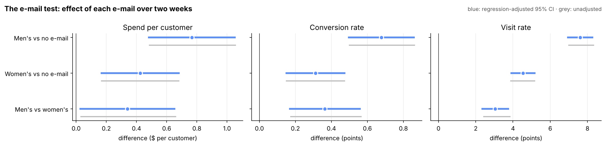
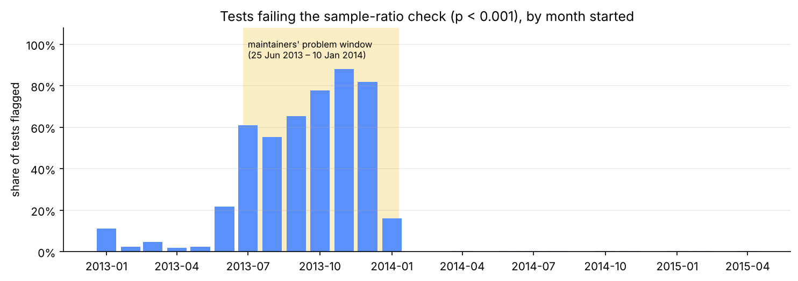
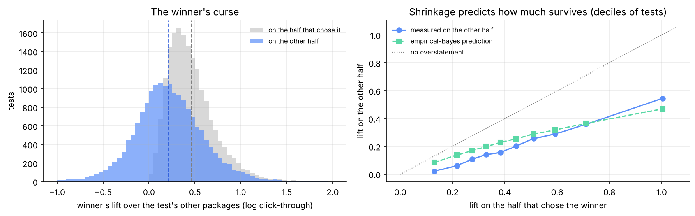

# 🧪 A/B testing on real experiments


> One real randomized experiment taken from analysis plan to rollout, then 22,743 real
> experiments read as a testing programme. Analysis plans were committed before the results;
> every number in the docs is checked against the recorded results in CI.

## TL;DR

| Question | Answer |
|---|---|
| **Which e-mail should a retailer send?** (Hillstrom test, 64,000 customers) | **The men's merchandise e-mail, to everyone.** +$0.77 spend per customer [+0.48, +1.05] over two weeks, worth about **$207 per 1,000 e-mailed**; it beats the women's e-mail by $0.34 [+0.03, +0.65]. Targeting by segment looked better in the search but not on held-out customers (−$0.01 [−$0.28, +$0.26]). |
| **Would a routine sample-ratio check have caught a known randomization bug?** (Upworthy, 22,743 headline tests) | **Yes.** Not told the dates, it flags **70%** of tests in the maintainers' broken six-month window and **0.5%** outside it. |
| **How much should a winning headline's lift be trusted?** | **About half.** Only **47%** of a winner's observed lift survives on fresh traffic; empirical-Bayes shrinkage predicts most of the drop. Picking winners still beat a random headline by **+20%** click-through. |



**Start here:** the [decision memo](./reports/decision_memo.md) (5 minutes), then
[notebook 02](./notebooks/02_email_test_readout.ipynb) for the readout itself.

---

## The experiment lifecycle, and where each step is

The Hillstrom e-mail test is the spine: one experiment, followed through every stage. The other
two parts add what a single test can't show.

| Stage | Where |
|---|---|
| **1. Plan before seeing results:** metrics, caps, comparisons, decision rule | [`reports/hillstrom_analysis_plan.md`](./reports/hillstrom_analysis_plan.md) (git history shows it landing first) |
| **2. Design:** smallest detectable effect, sample size needed | [Notebook 01](./notebooks/01_email_test_checks.ipynb) §0; deeper power analysis in [StreamFlix 02](./notebooks/streamflix/02_power_analysis.ipynb) |
| **3. Trust the data:** sample ratio, covariate balance, impossible rows | [Notebook 01](./notebooks/01_email_test_checks.ipynb); at programme scale in [notebook 04](./notebooks/04_programme_sample_ratio.ipynb) |
| **4. Read out:** intervals, regression adjustment (CUPED idea), Holm across comparisons | [Notebook 02](./notebooks/02_email_test_readout.ipynb); Bayesian version in [StreamFlix 04](./notebooks/streamflix/04_bayesian.ipynb) |
| **5. Decide:** dollars per 1,000 e-mailed, break-even margin | [Notebook 02](./notebooks/02_email_test_readout.ipynb) §3 |
| **6. Who benefits:** segment search with a held-out confirmation half | [Notebook 03](./notebooks/03_email_test_targeting.ipynb) |
| **7. Pitfalls:** winner's curse, peeking | [Notebook 05](./notebooks/05_programme_winners.ipynb); [StreamFlix 07](./notebooks/streamflix/07_sensitivity_robustness.ipynb) (sequential looks) |
| **8. Roll out:** holdback sizing, guardrails, the next test | [Notebook 02](./notebooks/02_email_test_readout.ipynb) §5 |

---

## Part 1 · One test, plan to rollout (Hillstrom e-mail test)

Kevin Hillstrom's MineThatData e-mail test (2008): 64,000 customers randomized in equal thirds to a
men's merchandise e-mail, a women's merchandise e-mail or no e-mail; visits, purchases and spend
over the following two weeks.

| Notebook | What it answers |
|---|---|
| [01 · Design and trust](./notebooks/01_email_test_checks.ipynb) | Could the test detect an effect worth acting on? (A $0.31 lift per customer, against $0.25 to break even, so only just.) Did randomization work? (Sample ratio p = 0.90; largest imbalance 0.02 SD.) |
| [02 · Readout, decision, rollout](./notebooks/02_email_test_readout.ipynb) | Each e-mail's effect on spend, purchases and visits, with and without regression adjustment; the plan's decision rule applied; a 5% holdback sized for rollout; the next test sized. |
| [03 · Targeting](./notebooks/03_email_test_targeting.ipynb) | Does sending different e-mails to different segments beat one e-mail for all? Searched on one half of the customers, confirmed on the other: no. |

## Part 2 · Scaling up: a testing programme (Upworthy Research Archive)

Every headline test Upworthy ran from 2013 to 2015 (CC BY 4.0). The maintainers split the tests into
exploratory, confirmatory and holdout samples; the [plan](./reports/upworthy_analysis_plan.md) was
written on the exploratory sample and pushed before the confirmatory one was analysed.

| Notebook | What it answers |
|---|---|
| [04 · Sample-ratio check](./notebooks/04_programme_sample_ratio.ipynb) | Does a standard check find the maintainers' broken-randomization window without being told it? |
| [05 · Winners](./notebooks/05_programme_winners.ipynb) | How different are headlines really? How much does the winner overstate itself? What did testing buy? Plus the holdout rerun. |




**Method note.** Each package's sessions are split in two at random. Half A picks the winner and
half B, which played no part in choosing it, measures it; the covariance of a package's two
half-sample results estimates how much packages truly differ, with no model of the noise.

## Appendix · StreamFlix: the full workflow on simulated data

The project's first version, kept whole: a simulated homepage test with a planted effect and a
planted Android assignment bug, analysed through eight notebooks (data quality, power, frequentist,
Bayesian, segmentation and CUPED, sensitivity and sequential testing, recovery of the known truth).
Because the true answer is known, it shows the methods work. See
[`notebooks/streamflix/README.md`](./notebooks/streamflix/README.md).

---

## Repository layout

```
├── README.md
├── data/
│   ├── README.md              # sources, licences, how to get the Hillstrom file, checksums
│   ├── upworthy/              # compact Upworthy samples (CC BY 4.0), committed
│   ├── raw/                   # Hillstrom CSV goes here (not committed)
│   ├── experiment.csv         # StreamFlix simulated data
│   └── streamflix.md
├── notebooks/
│   ├── 01–03_email_test_*     # Part 1 (.py source + executed .ipynb)
│   ├── 04–05_programme_*      # Part 2
│   └── streamflix/            # Appendix
├── reports/
│   ├── decision_memo.md       # start here
│   ├── hillstrom_analysis_plan.md, upworthy_analysis_plan.md
│   ├── metrics/               # every recorded result (JSON)
│   ├── figures/
│   └── streamflix/            # appendix memo, summary, brief
├── src/
│   ├── data/                  # hillstrom.py, upworthy.py, simulate.py, loader.py
│   ├── analysis/              # readout.py, programme.py, power.py, frequentist.py, bayesian.py, ...
│   └── records.py
├── app/streamlit_app.py       # interactive demo
├── scripts/                   # build_notebooks.py, check_metrics.py
└── tests/
```

## Reproduce

```bash
pip install -r requirements.txt
pytest                                   # methods, known-truth checks, reported numbers, app
python notebooks/04_programme_sample_ratio.py      # Part 2 runs on the committed data
```

Part 1 needs the Hillstrom CSV in `data/raw/` (free download, link and SHA-256 in
[`data/README.md`](./data/README.md)); it is not redistributed here because its licence is not
stated. Without it, notebooks 01–03 run on a synthetic stand-in with planted effects, which is what
CI does. `python scripts/build_notebooks.py --execute` rebuilds every notebook with outputs.

**CI** lints, runs the tests, checks each `.ipynb` matches its `.py` source, re-runs every
notebook (including the StreamFlix appendix), and checks the re-computed results match the
committed ones.

## Interactive demo

[janeruxi1-ab-testing-project.streamlit.app](https://janeruxi1-ab-testing-project.streamlit.app/):
the e-mail test readout, a sample-size calculator, a Bayesian readout for any counts, and an
"is this winner real?" explorer on the Upworthy tests. `streamlit run app/streamlit_app.py` locally.

## Limits

- **Hillstrom** is from 2008, its retailer is unnamed, and the margin (40%) and cost per e-mail
  ($0.10) are assumptions. It is widely analysed, so the plan cannot make the analysis blind to
  the headline result; it fixes everything a result could be tuned through.
- **Upworthy** measures clicks, not reading or sharing.
- **Regression adjustment** narrowed intervals by under 2% here: the pre-send variables say
  little about two-week spend. The StreamFlix appendix shows a case where CUPED helps.

## Related work

[`StreamFlix-Churn-Retention`](https://github.com/janeruxi1/StreamFlix-Churn-Retention) (who to
keep, and how) and [`StreamFlix-RAG-evaluation`](https://github.com/janeruxi1/StreamFlix-RAG-evaluation)
(is an AI support assistant safe to deploy?).

## Author

Xi Ru · [LinkedIn](https://www.linkedin.com/in/xiru) · [Email](mailto:ruthruxi@gmail.com)
